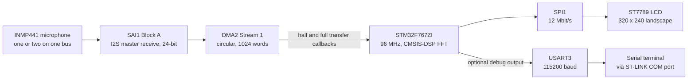

# STM32 Audio Spectrum Analyzer (ST7789 + INMP441)

Real-time audio spectrum analyzer on a Nucleo-F767ZI, using an INMP441 I2S microphone and a 2-inch ST7789 LCD.

[](LICENSE)


<p align="center">
  
</p>
<p align="center"><em>The analyzer running on the Waveshare 2-inch LCD Module.</em></p>

Video showcasing the project:

https://github.com/user-attachments/assets/57763690-d332-40a8-a951-e2d1e84b5693

Project done on a Nucleo-F767ZI board. The STM32 reads audio from an INMP441 MEMS microphone over I2S, runs an FFT on it and draws the spectrum as bars on a Waveshare 2-inch ST7789 LCD. It's an STM32CubeIDE project built on the STM32F7 HAL and CMSIS-DSP.

## Features

- Double-buffered audio capture with SAI1 (I2S, 24-bit) and circular DMA.
- 256-point FFT per channel with CMSIS-DSP.
- One or two microphones on the same I2S bus. The left and right spectra are summed.
- Only the part of each bar that changed gets redrawn, instead of the whole screen.
- Peak frequency readout, updated once a second.
- Optional UART output of raw microphone/FFT data.

## Hardware

| Part | Qty | Used for |
|------|-----|----------|
| ST Nucleo-F767ZI (STM32F767ZIT6, Cortex-M7) | 1 | MCU board. The on-board ST-LINK is used for flashing, debugging and the UART virtual COM port |
| INMP441 I2S MEMS microphone | 1 (2 for stereo) | Audio input |
| [Waveshare 2inch LCD Module](https://www.waveshare.com/wiki/2inch_LCD_Module) (ST7789, 240 x 320, SPI) | 1 | Display |
| Pull-down resistor | 1 | INMP441 L/R pin |
| Jumper wires, USB cable | - | Connections, power and programming |



### Display wiring

Wiring for the ST7789 display ([Waveshare wiki](https://www.waveshare.com/wiki/2inch_LCD_Module)). The CS, DC, RST and BLK labels are in [`Core/Inc/main.h`](Core/Inc/main.h).

| LCD pin | Nucleo pin | Function |
|---------|------------|----------|
| VCC | 3.3 V | Supply |
| GND | GND | Ground |
| DIN | PA7 | SPI1_MOSI |
| CLK | PA5 | SPI1_SCK |
| CS | PG2 | GPIO output |
| DC | PG3 | GPIO output (data/command select) |
| RST | PF12 | GPIO output |
| BL (optional) | PA0 or not connected | TIM2_CH1 PWM |

BL can stay unconnected. PA0 is set up as TIM2 PWM, but the firmware never starts the timer.

### Microphone wiring

Wiring for the INMP441 microphone ([datasheet](https://invensense.tdk.com/wp-content/uploads/2015/02/INMP441.pdf)):

<p align="center">
  
</p>
<p align="center"><em>Stereo setup from the INMP441 datasheet (Figure 7).</em></p>

| INMP441 pin | Nucleo pin | Function |
|-------------|------------|----------|
| VCC | 3.3 V | Supply |
| GND | GND | Ground |
| SD | PE6 | SAI1_SD_A (serial data) |
| WS | PE4 | SAI1_FS_A (word select) |
| SCK | PE5 | SAI1_SCK_A (bit clock) |
| L/R | GND or 3.3 V | GND = left, 3.3 V = right |

Additionally, add a pull-down resistor to GND for the L/R channels. Without it, the microphone tends to switch audio channels when transmitting data.

For stereo, wire a second INMP441 in parallel on SCK, WS and SD with its L/R pin tied to 3.3 V, like in the datasheet figure above.

## How it works

The application code is in [`Core/Src/main.c`](Core/Src/main.c). The rest of `Core/` is generated by STM32CubeMX and STM32CubeIDE.

1. SAI1 receives the I2S audio and DMA2 writes it into a 1024-word circular buffer. The half- and full-transfer callbacks tell the main loop which half is ready, so one half can be processed while the other one fills.
2. The main loop splits each 512-word half into 256 left and 256 right samples, sign-extends the 24-bit samples and converts them to float.
3. CMSIS-DSP runs a 256-point real FFT (`arm_rfft_fast_f32`) on each channel, giving 129 magnitude bins (DC to Nyquist). That's 187.5 Hz per bin at the nominal 48 kHz rate.
4. The left and right magnitudes are summed and drawn as bars on the 320 x 240 landscape display.
5. Once a second, the strongest bin is converted to hertz and shown as `Peak Frequency` at the bottom right.

A few design notes:

- Bars rise right away and fall 44 px per frame, which gives a decay effect.
- There's no frame-rate timer. One frame is drawn for each DMA half-buffer the main loop services, and the actual update rate is limited by the FFT and SPI drawing time.
- Every 60 s the top third of the bar area is cleared to get rid of pixels that stay white.
- Buffer sizes, the FFT length, the fall speed and the other settings are at the top of `main.c` or inside `drawSpectrum()`. The buffer sizes depend on each other, so change them together.
- CubeMX reports the real SAI rate as 46.875 kHz (2.34% below 48 kHz), but the code uses 48000 for all frequency calculations, so the peak readout runs about 2% high.

## CubeMX configuration

<p align="center">
  
</p>
<p align="center"><em>SPI1 settings for the display.</em></p>

<p align="center">
  
  
</p>
<p align="center"><em>SAI1 Block A settings for the microphone, and its DMA settings.</em></p>

## Getting started

The repo root holds the sources for browsing, but it can't be built on its own because the linker scripts and the debug launch configuration aren't in it. The full STM32CubeIDE project is in [`project.zip`](project.zip).

1. Install [STM32CubeIDE](https://www.st.com/en/development-tools/stm32cubeide.html).
2. Clone the repo:

   ```sh
   git clone https://github.com/OscarBazylewich/STM32_Audio_Spectrum_Analyzer_ST7789_and_INMP441.git
   ```

3. Extract `project.zip`, for example into your STM32CubeIDE workspace. It contains one folder, `Nucleo-F767ZI-AudioSpectrumAnalyzer/`.
4. In STM32CubeIDE, go to **File > Import... > General > Existing Projects into Workspace**, select the extracted folder and click **Finish**.
5. Build the **Debug** configuration. It already has the include paths for the ST7789 and CMSIS-DSP drivers and the `-u _printf_float` linker flag that the peak frequency text needs. The Release configuration doesn't.
6. Connect the Nucleo through its ST-LINK USB port and run the included **Nucleo-F767ZI-AudioSpectrumAnalyzer Debug** launch configuration.
7. After reset, the display shows the `0-24KHz` label and the live spectrum.

If you'd rather regenerate the code from the [`.ioc`](Nucleo-F767ZI-AudioSpectrumAnalyzer.ioc) in STM32CubeMX, keep `Drivers/ST7789` and `Drivers/CMSIS_DSP`, add their include paths and add `-u _printf_float` to the linker flags. "Keep user code" is on, so the code between the `USER CODE` markers in `main.c` is preserved.

### UART debug output (optional)

Optional UART configuration to see raw microphone/FFT data through a terminal (see more in `main.c`). USART3 runs at 115200 baud, 8N1, and goes through the ST-LINK, so it shows up on its virtual COM port. I left two commented-out debug blocks in the main loop: one prints raw left/right samples, the other prints the frequency and left/right magnitudes for bins 1 to 128. Uncomment one, rebuild and open a terminal at 115200 baud. They use blocking `HAL_UART_Transmit()` calls, so the display updates slower while they're on.

<p align="center">
  
</p>
<p align="center"><em>USART3 settings for the debug output.</em></p>

## Repository structure

```text
.
├── Core/
│   ├── Inc/                     # main.h (pin labels), HAL config
│   ├── Src/
│   │   ├── main.c               # The application: DMA callbacks, FFT, drawing, peripheral init
│   │   └── ...                  # Generated: pin muxing, interrupts, system init
│   └── Startup/                 # Startup code and vector table
├── Drivers/
│   ├── CMSIS/                   # Arm CMSIS core and STM32F7 device headers
│   ├── CMSIS_DSP/               # CMSIS-DSP library
│   ├── ST7789/                  # ST7789 LCD driver and fonts by Golinskiy Konstantin
│   └── STM32F7xx_HAL_Driver/    # STM32F7 HAL
├── .gitattributes               # Marks Drivers/ as vendored for GitHub language stats
├── Nucleo-F767ZI-AudioSpectrumAnalyzer.ioc  # STM32CubeMX configuration
├── project.zip                  # Full STM32CubeIDE project (build this one)
├── LICENSE
└── README.md
```

## Related projects

- [STM32_Audio_Spectrum_Analyzer_CustomPCB](https://github.com/OscarBazylewich/STM32_Audio_Spectrum_Analyzer_CustomPCB): a custom PCB version of this analyzer, built around an STM32L4Q5.

## Credits

- Credits to Golinskiy Konstantin for the ST7789 display drivers and fonts ([`Drivers/ST7789`](Drivers/ST7789)).
- STM32F7 HAL, CMSIS device files and generated startup code by STMicroelectronics ([license](Drivers/STM32F7xx_HAL_Driver/LICENSE.txt)).
- CMSIS and CMSIS-DSP by Arm, under the Apache License 2.0.
- Microphone block diagram from the TDK InvenSense INMP441 datasheet.

## License

Released under the [MIT License](LICENSE). Vendored code in `Drivers/` keeps its original license.
