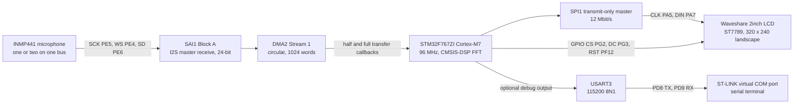
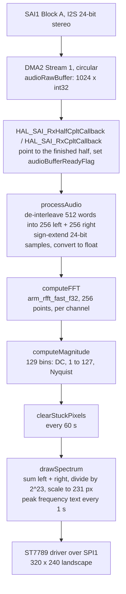

# STM32 Audio Spectrum Analyzer (ST7789 + INMP441)

Real-time audio spectrum analyzer for the ST NUCLEO-F767ZI: an INMP441 I2S MEMS microphone captured by the SAI peripheral over DMA, a 256-point CMSIS-DSP FFT, and a 320 × 240 bar display on a Waveshare 2-inch ST7789 SPI LCD.

[](LICENSE)


<p align="center">
  
</p>
<p align="center"><em>The analyzer running on the Waveshare 2-inch LCD Module.</em></p>

Demo video:

https://github.com/user-attachments/assets/57763690-d332-40a8-a951-e2d1e84b5693

## Table of contents

- [Overview](#overview)
- [Hardware](#hardware)
- [Firmware](#firmware)
- [Getting started](#getting-started)
- [Repository structure](#repository-structure)
- [Related projects](#related-projects)
- [Credits](#credits)
- [License](#license)

## Overview

The firmware streams 24-bit stereo I2S audio from one or two INMP441 microphones into a circular DMA buffer through SAI1 Block A. When a half-buffer of 256 stereo frames is ready, the main loop converts it to floating point, runs a 256-point real FFT (`arm_rfft_fast_f32`) on each channel and draws the result as vertical bars on a 320 × 240 ST7789 display over SPI1. It is an STM32CubeMX / STM32CubeIDE project built on the STM32F7 HAL, written for the NUCLEO-F767ZI development board.

### Features

- Double-buffered audio capture: SAI1 in I2S master-receive mode, 24-bit data, 2 slots, DMA2 Stream 1 in circular mode with half- and full-transfer callbacks.
- 256-point real FFT per channel with CMSIS-DSP; 129 magnitude bins (DC to Nyquist), 187.5 Hz per bin at the nominal 48 kHz rate.
- One or two microphones on the same I2S bus: the left and right slots are processed separately and their magnitude spectra are summed.
- Incremental drawing: only the segment between a bar's old and new height is redrawn, instead of the whole frame. Bars rise immediately and fall by 44 pixels per frame.
- Peak-frequency readout refreshed once per second, plus a periodic clean-up of stuck pixels every 60 s.
- Optional raw-sample and FFT-bin dumps over USART3 (115200 baud) to the ST-LINK virtual COM port.

## Hardware

### Bill of materials

| Qty | Part | Role |
|-----|------|------|
| 1 | ST NUCLEO-F767ZI (STM32F767ZIT6, Arm Cortex-M7, LQFP144) | MCU board; the on-board ST-LINK is used for flashing, debugging and the UART virtual COM port |
| 1 (2 for stereo) | INMP441 I2S MEMS microphone | Audio input; a second microphone on the right I2S slot is optional |
| 1 | [Waveshare 2inch LCD Module](https://www.waveshare.com/wiki/2inch_LCD_Module) (ST7789, 240 × 320, SPI) | Spectrum display |
| 1 | Pull-down resistor | Holds the INMP441 L/R pin low (see [microphone wiring](#microphone-wiring)) |
| - | Jumper wires, USB cable | Connections and ST-LINK power / programming |

### System block diagram



### Display wiring

Pin assignments come from [`Core/Inc/main.h`](Core/Inc/main.h), [`Core/Src/stm32f7xx_hal_msp.c`](Core/Src/stm32f7xx_hal_msp.c) and the CubeMX configuration. Module documentation: [Waveshare 2inch LCD Module wiki](https://www.waveshare.com/wiki/2inch_LCD_Module).

| LCD pin | NUCLEO-F767ZI pin | Function |
|---------|-------------------|----------|
| VCC | 3.3 V | Supply |
| GND | GND | Ground |
| DIN | PA7 | SPI1_MOSI |
| CLK | PA5 | SPI1_SCK |
| CS | PG2 | GPIO output `CS` |
| DC | PG3 | GPIO output `DC` (data / command select) |
| RST | PF12 | GPIO output `RST` |
| BL (optional) | PA0 or not connected | Labelled `BLK`, configured as TIM2_CH1 PWM |

Notes:

- PA0 is set up as TIM2 channel 1 PWM (prescaler 96, period 100, so 5 kHz from the 48 MHz APB1 timer clock), but the firmware never starts the timer and `ST7789_SetBL()` in the driver is an empty stub. BL can be left unconnected, as in the original wiring.
- The driver's chip-select code is compiled out (`CS_PORT` is not defined in [`st7789.h`](Drivers/ST7789/st7789.h)). PG2 is driven low once during GPIO initialisation and stays low, so the display is permanently selected and should be the only device on SPI1.

### Microphone wiring

Datasheet: [INMP441 (TDK InvenSense)](https://invensense.tdk.com/wp-content/uploads/2015/02/INMP441.pdf).

<p align="center">
  
</p>
<p align="center"><em>Stereo configuration from the INMP441 datasheet (Figure 7, System Block Diagram).</em></p>

| INMP441 pin | NUCLEO-F767ZI pin | Function |
|-------------|-------------------|----------|
| VCC | 3.3 V | Supply |
| GND | GND | Ground |
| SD | PE6 | SAI1_SD_A (serial data) |
| WS | PE4 | SAI1_FS_A (frame sync / word select) |
| SCK | PE5 | SAI1_SCK_A (bit clock) |
| L/R | GND or 3.3 V | Slot select: GND = left, 3.3 V = right |

Add a pull-down resistor to GND on the L/R pin. Without it, the microphone tends to switch audio channels while it is transmitting data. For a stereo setup, wire a second INMP441 in parallel on SCK, WS and SD with its L/R pin tied to 3.3 V, as shown in the datasheet figure above.

The connector locations of these pins on the board headers are listed in ST's NUCLEO-F767ZI (Nucleo-144) user manual.

## Firmware

The application logic lives in [`Core/Src/main.c`](Core/Src/main.c). The rest of `Core/` is generated code: STM32CubeMX output from [`Nucleo-F767ZI-AudioSpectrumAnalyzer.ioc`](Nucleo-F767ZI-AudioSpectrumAnalyzer.ioc), plus `syscalls.c` and `sysmem.c` from STM32CubeIDE.

### Clocks and peripherals

| Block | Configuration | Source |
|-------|---------------|--------|
| System clock | 96 MHz SYSCLK/HCLK from the 8 MHz HSE in bypass mode (MCO from the ST-LINK), PLL M = 4, N = 96, P = 2; APB1 24 MHz, APB2 48 MHz | `SystemClock_Config()` in `main.c` |
| SAI1 Block A | Master receive, asynchronous, I2S standard protocol, 24-bit data, 2 slots, stereo, master clock divider enabled, 48 kHz target; kernel clock 48 MHz from PLLSAI (N = 96, Q = 4) | `MX_SAI1_Init()`, `HAL_SAI_MspInit()` |
| DMA2 Stream 1, channel 0 | SAI1_A peripheral-to-memory, circular, word to word, memory increment, FIFO disabled, low priority; IRQ priority 0 | `HAL_SAI_MspInit()`, `MX_DMA_Init()` |
| SPI1 | Transmit-only master, 8-bit, MSB first, CPOL high, CPHA second edge, software NSS, prescaler 4 (12 Mbit/s from 48 MHz APB2) | `MX_SPI1_Init()`, `.ioc` |
| USART3 | 115200 baud, 8N1, TX and RX, no flow control; PD8 / PD9 routed to the ST-LINK | `MX_USART3_UART_Init()` |
| TIM2 channel 1 | PWM on PA0 (`BLK`), prescaler 96, period 100; configured but not started | `MX_TIM2_Init()` |

STM32CubeMX reports the real SAI frame rate as 46.875 kHz, which is 2.34 % below the 48 kHz target with a 48 MHz SAI kernel clock. The firmware uses the nominal value (`SAMPLING_FREQUENCY 48000`) for all frequency calculations.

USB OTG FS (device mode), the green LED LD1 on PB0 and PC3 (I2S2_SD) are also initialised by the generated code but are not used by the application.

<p align="center">
  
</p>
<p align="center"><em>SPI1 configuration for the display.</em></p>

<p align="center">
  
  
</p>
<p align="center"><em>SAI1 Block A parameters and its DMA request settings.</em></p>

### Signal processing pipeline



1. **Capture.** `HAL_SAI_Receive_DMA()` starts a circular transfer into `int32_t audioRawBuffer[1024]`. The half-transfer callback points `audioBufferPtr` at the first 512 words and the transfer-complete callback points it at the second 512; both set `audioBufferReadyFlag`.
2. **Conversion.** The main loop polls the flag and calls `processAudio()`, which splits the interleaved words into 256 left and 256 right samples, sign-extends bit 23 of each 24-bit sample to 32 bits and stores the result as `float`.
3. **FFT.** `arm_rfft_fast_init_f32()` sets up a 256-point instance once at start-up, and `arm_rfft_fast_f32()` runs a forward transform on each channel. No window function is applied.
4. **Magnitude.** `computeMagnitude()` computes `sqrtf(re² + im²)` for bins 1 to 127 and takes the DC and Nyquist terms from the first two elements of the packed CMSIS-DSP output, giving 129 bins per channel.
5. **Rendering.** `clearStuckPixels()` and `drawSpectrum()` update the display (see below).

There is no frame-rate timer. One frame is drawn for every DMA half-buffer the main loop services. The half-buffer period is 256 stereo frames (about 5.3 ms at 48 kHz), and the actual update rate is limited by the FFT and SPI drawing time. Half-buffer events that arrive while a frame is still being drawn are merged into one, because the ready flag is a single variable.

### Display rendering

- The display is used in landscape mode via `ST7789_rotation(2)` (320 × 240, 16-bit RGB565 colour). The driver is configured for the 2-inch 240 × 320 panel with `ST7789_IS_240X320`.
- Left and right magnitudes are summed per bin, divided by 2^23 (8388608, which the code comments tie to the INMP441's 24-bit data) and multiplied by the maximum bar height of 231 px, then clamped. The bottom 9 rows are reserved for text.
- The 128 bins from 1 to Nyquist are spread across the 320 px width at 2.5 px per bin, each drawn 2 px wide. Bins 1 to 127 are visible; the Nyquist bin falls just past the right edge.
- A per-column height array (`previousHeight`) makes drawing incremental. Rising bars are extended in white with vertical `ST7789_DrawLine()` calls, which the driver turns into 1-pixel-wide `ST7789_FillRect()` fills. A column whose new value is below its current height is shortened by 44 px per frame (`speedOfFade`), clamped at zero, by drawing the removed segment in black, which gives a decay effect.
- The text uses the driver's `Font_7x9` in white on the black background: a static `0-24KHz` label at the bottom left, and `Peak Frequency: <Hz>` at the bottom right. Once per second the firmware finds the bin with the largest summed magnitude (excluding DC) and converts it to hertz as `bin × 48000 / 256`.
- Every 60 s (`STUCK_PIXEL_CLEAR_MS`), the top third of the bar area is filled with black and the height history is reset, to clear pixels that stay white.

### Tunable parameters

All of the following are defined at the top of [`main.c`](Core/Src/main.c) or as local settings inside `drawSpectrum()`.

| Name | Value | Meaning |
|------|-------|---------|
| `AUDIO_BUFFER_SIZE` | 1024 | 32-bit words in the circular DMA buffer (two halves) |
| `PROCESSED_AUDIO_SIZE` | 512 | Words processed per half-buffer event (256 stereo frames) |
| `AUDIO_CHANNEL_BUFFER_SIZE` | 256 | Samples per channel per frame |
| `FFT_CHANNEL_BUFFER_SIZE` | 256 | FFT length |
| `FFT_MAGNITUDE_BUFFER_SIZE` | 128+1 | Magnitude bins, DC to Nyquist |
| `SAMPLING_FREQUENCY` | 48000 | Sample rate used for frequency calculations, in Hz |
| `DISPLAY_WIDTH` × `DISPLAY_HEIGHT` | 320 × 240 | Drawing area, assuming `ST7789_rotation(2)` |
| `STUCK_PIXEL_CLEAR_MS` | 60000 | Stuck-pixel clean-up interval, in ms |
| `speedOfFade` | 44 | Pixels a falling bar drops per frame |
| `maxHeight` | 240 (clamped to 231) | Maximum bar height in pixels |
| `xOffset` / `yOffset` | 0 / 9 | Spectrum offset from the left / bottom edge, in pixels |

The buffer sizes depend on each other. Each half of `AUDIO_BUFFER_SIZE` is `PROCESSED_AUDIO_SIZE`, which de-interleaves into two `AUDIO_CHANNEL_BUFFER_SIZE` channel buffers that are fed to the FFT. Change them together.

### UART debug output

USART3 is configured at 115200 baud, 8N1, and is routed to the on-board ST-LINK, so its output appears on the ST-LINK virtual COM port. The main loop in `main.c` contains two debug blocks that are commented out:

- **Raw samples:** the first 16 left / right sample pairs of each frame, as `L:<left> R:<right>`.
- **FFT data:** one line per bin from 1 to 128, giving the frequency, left magnitude and right magnitude separated by tabs.

Uncomment one block, rebuild, and open a terminal on the ST-LINK COM port at 115200 baud. The blocks use blocking `HAL_UART_Transmit()` calls, so enabling them slows down the display update.

<p align="center">
  
</p>
<p align="center"><em>USART3 configuration for the optional debug output.</em></p>

## Getting started

### Prerequisites

- [STM32CubeIDE](https://www.st.com/en/development-tools/stm32cubeide.html) with its bundled GNU Tools for STM32 toolchain.
- Optional, to regenerate the code: [STM32CubeMX](https://www.st.com/en/development-tools/stm32cubemx.html) 6.17.0 or newer (the version that saved the `.ioc`) and the STM32Cube FW_F7 V1.17.4 package.
- The hardware listed in the [bill of materials](#bill-of-materials), wired as shown above.
- Optional: any serial terminal for the UART debug output.

### Build and flash

The repository root holds the sources for browsing, but it cannot be built on its own because the linker scripts and the debug launch configuration are not in the root. The complete STM32CubeIDE project is in [`project.zip`](project.zip).

1. Clone the repository:

   ```sh
   git clone https://github.com/OscarBazylewich/STM32_Audio_Spectrum_Analyzer_ST7789_and_INMP441.git
   ```

2. Extract `project.zip` to a working location, for example your STM32CubeIDE workspace. It contains a single folder, `Nucleo-F767ZI-AudioSpectrumAnalyzer/`, with the `.project` / `.cproject` files, `STM32F767ZITX_FLASH.ld` / `STM32F767ZITX_RAM.ld`, `Core/Startup/startup_stm32f767zitx.s`, the `.ioc`, the `Drivers/` folder and a debug launch configuration.
3. In STM32CubeIDE, choose **File > Import... > General > Existing Projects into Workspace**, select the extracted `Nucleo-F767ZI-AudioSpectrumAnalyzer` folder and click **Finish**.
4. Build the **Debug** configuration (**Project > Build Project**). It already contains the include paths for `Drivers/ST7789`, `Drivers/CMSIS_DSP/Include` and `Drivers/CMSIS_DSP/PrivateInclude`, and the `-u _printf_float` linker flag that the `%.1f` peak-frequency text needs. The Release configuration does not have these settings.
5. Connect the NUCLEO-F767ZI to the PC through its ST-LINK USB connector.
6. Start the included **Nucleo-F767ZI-AudioSpectrumAnalyzer Debug** launch configuration (**Run > Debug Configurations...**). It uses the ST-LINK GDB server over SWD.
7. After reset, the display shows the `0-24KHz` label and the live spectrum.

### Alternative: regenerate from the .ioc

1. Open [`Nucleo-F767ZI-AudioSpectrumAnalyzer.ioc`](Nucleo-F767ZI-AudioSpectrumAnalyzer.ioc) in STM32CubeMX. The target toolchain is STM32CubeIDE. The file also references the X-CUBE-ALGOBUILD 1.4.0 pack (DSP library), which CubeMX may ask you to install.
2. Generate the code. "Keep user code" is enabled, so the application code between the `USER CODE BEGIN` / `END` markers in `main.c` is preserved.
3. Keep `Drivers/ST7789` and `Drivers/CMSIS_DSP` in the project, add their include paths (see step 4 above) and add `-u _printf_float` to the linker flags.

## Repository structure

```text
.
├── Core/
│   ├── Inc/
│   │   ├── main.h                   # GPIO labels: CS, DC, RST, BLK and board pins
│   │   ├── stm32f7xx_hal_conf.h     # HAL module selection, HSE_VALUE = 8 MHz
│   │   └── stm32f7xx_it.h
│   ├── Src/
│   │   ├── main.c                   # Application: DMA callbacks, FFT, spectrum drawing, peripheral init
│   │   ├── stm32f7xx_hal_msp.c      # Pin muxing, PLLSAI clock for SAI1, DMA2 Stream 1 setup
│   │   ├── stm32f7xx_it.c           # Interrupt handlers, including DMA2_Stream1_IRQHandler
│   │   ├── syscalls.c               # Minimal system calls (STM32CubeIDE generated)
│   │   ├── sysmem.c                 # _sbrk() for the newlib heap
│   │   └── system_stm32f7xx.c       # CMSIS system init
│   └── Startup/
│       └── startup_stm32f767zitx    # GCC startup and vector table (.s extension missing here; present in project.zip)
├── Drivers/
│   ├── CMSIS/                       # Arm CMSIS core and STM32F7xx device headers (vendored)
│   ├── CMSIS_DSP/                   # CMSIS-DSP headers and sources, arm_math.h V1.10.0 (vendored)
│   ├── ST7789/                      # ST7789 LCD driver and fonts by Golinskiy Konstantin, plus bitmap data
│   └── STM32F7xx_HAL_Driver/        # STM32F7 HAL (vendored)
├── .gitattributes                   # Marks Drivers/** as vendored for GitHub language stats
├── LICENSE                          # MIT
├── Nucleo-F767ZI-AudioSpectrumAnalyzer.ioc  # STM32CubeMX configuration (pins, clocks, SAI, SPI, UART, DMA)
├── project.zip                      # Complete STM32CubeIDE project, including the Debug/ build output from the author's workspace
└── README.md
```

## Related projects

- [STM32_Audio_Spectrum_Analyzer_CustomPCB](https://github.com/OscarBazylewich/STM32_Audio_Spectrum_Analyzer_CustomPCB): a custom PCB version of the analyzer, built around an STM32L4Q5.

## Credits

- ST7789 display driver and fonts ([`Drivers/ST7789`](Drivers/ST7789)) by Golinskiy Konstantin.
- STM32F7 HAL, CMSIS device files and generated start-up code by STMicroelectronics ([`Drivers/STM32F7xx_HAL_Driver/LICENSE.txt`](Drivers/STM32F7xx_HAL_Driver/LICENSE.txt)).
- CMSIS and CMSIS-DSP by Arm, under the Apache License 2.0.
- Microphone system block diagram taken from the TDK InvenSense INMP441 datasheet.

## License

The project is released under the [MIT License](LICENSE). Vendored code in `Drivers/` keeps its original license.
