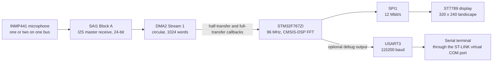

# STM32 Audio Spectrum Analyzer (ST7789 + INMP441)

This project is a real-time audio spectrum analyzer on a Nucleo-F767ZI board. It uses an INMP441 I2S microphone and a 2-inch ST7789 display.

[](LICENSE)


<p align="center">
  
</p>

This video shows the project:

https://github.com/user-attachments/assets/57763690-d332-40a8-a951-e2d1e84b5693

The STM32F767ZI reads audio from an INMP441 MEMS microphone through I2S. It calculates an FFT of the audio and shows the spectrum as bars on the ST7789 display (Waveshare 2inch LCD Module). This STM32CubeIDE project uses the STM32F7 HAL and CMSIS-DSP.

## Features

- SAI1 (I2S, 24-bit) receives the audio. In circular mode, DMA2 writes the audio into a circular buffer with two half-buffers.
- CMSIS-DSP calculates a 256-point FFT for each channel.
- You can connect one or two microphones to the same I2S bus. The firmware adds the left spectrum and the right spectrum together.
- The firmware updates only the changed part of each bar. It does not update the full display.
- The display shows the peak frequency. The firmware updates this value one time each second.
- An optional UART output sends the raw microphone data and FFT data.

## Hardware

### Primary parts

| Part | Qty | Function |
|------|-----|----------|
| ST Nucleo-F767ZI (STM32F767ZIT6, Cortex-M7) | 1 | MCU board. The ST-LINK on the board loads and debugs the firmware. It also supplies the virtual COM port for the UART |
| INMP441 I2S MEMS microphone | 1 (2 for stereo) | Audio input |
| [Waveshare 2inch LCD Module](https://www.waveshare.com/wiki/2inch_LCD_Module) (ST7789, 240 x 320, SPI) | 1 | Display |
| Pull-down resistor | 1 | For the INMP441 L/R pin |
| Jumper wires, USB cable | - | To make the connections, to supply power and to load the firmware |

### Signal flow



### Display pinout

The table that follows shows the connections for the ST7789 display ([Waveshare wiki](https://www.waveshare.com/wiki/2inch_LCD_Module)). The labels for the CS, DC, RST and BL pins are in [`Core/Inc/main.h`](Core/Inc/main.h). In this file, the label for the BL pin is BLK.

| Display pin | Nucleo pin | Function |
|-------------|------------|----------|
| VCC | 3.3 V | Supply |
| GND | GND | Ground |
| DIN | PA7 | SPI1_MOSI |
| CLK | PA5 | SPI1_SCK |
| CS | PG2 | GPIO output |
| DC | PG3 | GPIO output (data/command select) |
| RST | PF12 | GPIO output |
| BL (optional) | PA0 or not connected | TIM2_CH1 PWM |

It is not necessary to connect the BL pin. PA0 has a TIM2 PWM configuration, but the firmware does not start the timer.

### Microphone pinout

The figure and the table that follow show the connections for the INMP441 microphone ([datasheet](https://invensense.tdk.com/wp-content/uploads/2015/02/INMP441.pdf)):

<p align="center">
  
</p>

| INMP441 pin | Nucleo pin | Function |
|-------------|------------|----------|
| VCC | 3.3 V | Supply |
| GND | GND | Ground |
| SD | PE6 | SAI1_SD_A (serial data) |
| WS | PE4 | SAI1_FS_A (word select) |
| SCK | PE5 | SAI1_SCK_A (bit clock) |
| L/R | GND or 3.3 V | GND = left channel, 3.3 V = right channel |

Also, connect a pull-down resistor between the L/R pin and GND.

**Note:** Without this resistor, the microphone frequently changes audio channels when it transmits data.

If you use two microphones (stereo), do these steps:

1. Make sure that the L/R pin of the first INMP441 connects to GND (with the pull-down resistor).
2. Connect the VCC pin of the second INMP441 to 3.3 V.
3. Connect the GND pin of the second INMP441 to GND.
4. Connect the second INMP441 to the same SCK, WS and SD lines.
5. Connect the L/R pin of the second INMP441 to 3.3 V.

## How the analyzer operates

The file [`Core/Src/main.c`](Core/Src/main.c) contains the application code. The other files in `Core/` contain generated code from STM32CubeMX and STM32CubeIDE.

1. SAI1 receives the I2S audio. DMA2 writes the audio into a 1024-word circular buffer. The half-transfer callback and the full-transfer callback tell the main loop which half-buffer has new data. Thus, the main loop can process this half-buffer while DMA2 fills the other half-buffer.
2. The main loop divides each 512-word half-buffer into 256 left samples and 256 right samples. Then it sign-extends the 24-bit samples and converts them to float.
3. CMSIS-DSP calculates a 256-point real FFT (`arm_rfft_fast_f32`) for each channel. The result is 129 magnitude bins (DC to Nyquist). At the specified rate of 48 kHz, the width of each bin is 187.5 Hz.
4. The main loop adds the left magnitudes and the right magnitudes together. Then it shows the sums as bars on the 320 x 240 landscape display.
5. One time each second, the main loop finds the bin with the largest magnitude. It converts this bin to a frequency in hertz. The display shows this frequency as `Peak Frequency` in the bottom right corner.

More information:

- The height of a bar increases immediately, but it decreases gradually. The height decreases by 44 px in each frame.
- There is no frame-rate timer. The firmware shows one frame for each DMA half-buffer that the main loop processes. The FFT time and the time to update the display through SPI1 set the limit of the frame rate.
- At intervals of 60 s, the firmware erases the top 1/3 of the bar area. This removes pixels that stay white.
- The settings are at the top of `main.c` or in `drawSpectrum()`. These settings include the buffer sizes, the FFT length and the speed at which the height of the bars decreases.
- The buffer sizes are related to each other. A change to one buffer size makes it necessary to change the other buffer sizes.
- STM32CubeMX shows that SAI1 operates at 46.875 kHz (2.34% less than 48 kHz). But the code uses 48000 to calculate all frequencies. Thus, the peak frequency value is approximately 2% too high.

## STM32CubeMX configuration

<p align="center">
  
</p>

<p align="center">
  
  
</p>

## How to start

The root folder of the repository contains the source files for you to read. You cannot build the project from only these files, because the root folder does not contain the linker scripts or the debug launch configuration. The file [`project.zip`](project.zip) contains the full STM32CubeIDE project.

1. Install [STM32CubeIDE](https://www.st.com/en/development-tools/stm32cubeide.html).
2. Clone the repository:

   ```sh
   git clone https://github.com/OscarBazylewich/STM32_Audio_Spectrum_Analyzer_ST7789_and_INMP441.git
   ```

3. Extract `project.zip`, for example into your STM32CubeIDE workspace. The ZIP file contains one folder, `Nucleo-F767ZI-AudioSpectrumAnalyzer/`.
4. In STM32CubeIDE, select **File > Import... > General > Existing Projects into Workspace**.
5. Click **Next**.
6. Click **Browse...** adjacent to **Select root directory**.
7. Select the extracted folder.
8. Click **Finish**.
9. Build the **Debug** configuration.

   **Note:** The Debug configuration contains the include paths for the ST7789 display driver and the CMSIS-DSP library. It also contains the `-u _printf_float` linker flag. This flag is necessary for the peak frequency text. The Release configuration does not contain these settings.

10. Connect the ST-LINK USB port of the Nucleo-F767ZI board to your computer with the USB cable.
11. Select **Run > Debug Configurations...**.
12. Select the included **Nucleo-F767ZI-AudioSpectrumAnalyzer Debug** launch configuration.
13. Click **Debug**.
14. When the debugger stops the firmware at `main()`, click **Resume** (F8).
15. Make sure that the display shows the `0-24KHz` text and a spectrum that changes with the sound.

If you use STM32CubeMX to make the code again from the [`.ioc`](Nucleo-F767ZI-AudioSpectrumAnalyzer.ioc) file, do these steps:

1. Keep `Drivers/ST7789` and `Drivers/CMSIS_DSP`.
2. Add the same include paths that the Debug configuration in `project.zip` uses for these two folders.
3. Add `-u _printf_float` to the linker flags.

The "Keep user code" setting is on. Thus, STM32CubeMX keeps the code between the `USER CODE` markers in `main.c`.

### UART debug output (optional)

This optional UART configuration lets you see the raw microphone data and FFT data in a serial terminal. For more information, refer to `main.c`.

USART3 operates at 115200 baud, 8N1. The USART3 data goes through the ST-LINK. Thus, the data is available on the virtual COM port of the ST-LINK.

The main loop contains two debug blocks:

- One debug block sends the raw left and right samples.
- The other debug block sends the frequency and the left and right magnitudes for bins 1 to 128.

Comment markers disable the two debug blocks.

To use a debug block, do these steps:

1. In the imported project, open `Core/Src/main.c`.
2. Remove the `/*` and `*/` markers around one debug block.
3. Build the project again.
4. Start the **Nucleo-F767ZI-AudioSpectrumAnalyzer Debug** launch configuration again.
5. When the debugger stops the firmware at `main()`, click **Resume** (F8).
6. Open a serial terminal on the ST-LINK virtual COM port at 115200 baud, 8N1.

The debug blocks use blocking `HAL_UART_Transmit()` calls. Thus, the firmware updates the display more slowly while a debug block is active.

<p align="center">
  
</p>

## Repository structure

```text
.
├── Core/
│   ├── Inc/                     # main.h (pin labels), HAL configuration
│   ├── Src/
│   │   ├── main.c               # The application: DMA callbacks, FFT, display updates, peripheral initialization
│   │   └── ...                  # Generated code: pin configuration, interrupts, system initialization
│   └── Startup/                 # Startup code and vector table
├── Drivers/
│   ├── CMSIS/                   # Arm CMSIS core and STM32F7 device headers
│   ├── CMSIS_DSP/               # CMSIS-DSP library
│   ├── ST7789/                  # ST7789 display driver and fonts from Golinskiy Konstantin
│   └── STM32F7xx_HAL_Driver/    # STM32F7 HAL
├── .gitattributes               # Tells GitHub not to count Drivers/ in its language statistics
├── Nucleo-F767ZI-AudioSpectrumAnalyzer.ioc  # STM32CubeMX configuration
├── project.zip                  # Full STM32CubeIDE project (build this project)
├── LICENSE
└── README.md
```

## Related projects

- [STM32_Audio_Spectrum_Analyzer_CustomPCB](https://github.com/OscarBazylewich/STM32_Audio_Spectrum_Analyzer_CustomPCB): This project has the same analyzer functions on a dedicated PCB with an STM32L4Q5CGT6.

## Credits

- The ST7789 display driver and fonts ([`Drivers/ST7789`](Drivers/ST7789)) are from Golinskiy Konstantin.
- The STM32F7 HAL, the CMSIS device files and the generated startup code are from STMicroelectronics ([license](Drivers/STM32F7xx_HAL_Driver/LICENSE.txt)).
- CMSIS and CMSIS-DSP are from Arm. Their license is the Apache License 2.0.
- The system block diagram (Figure 7) is from the TDK InvenSense INMP441 datasheet.

## License

The license of this project is the [MIT License](LICENSE). The third-party code in `Drivers/` keeps the license from its source.
